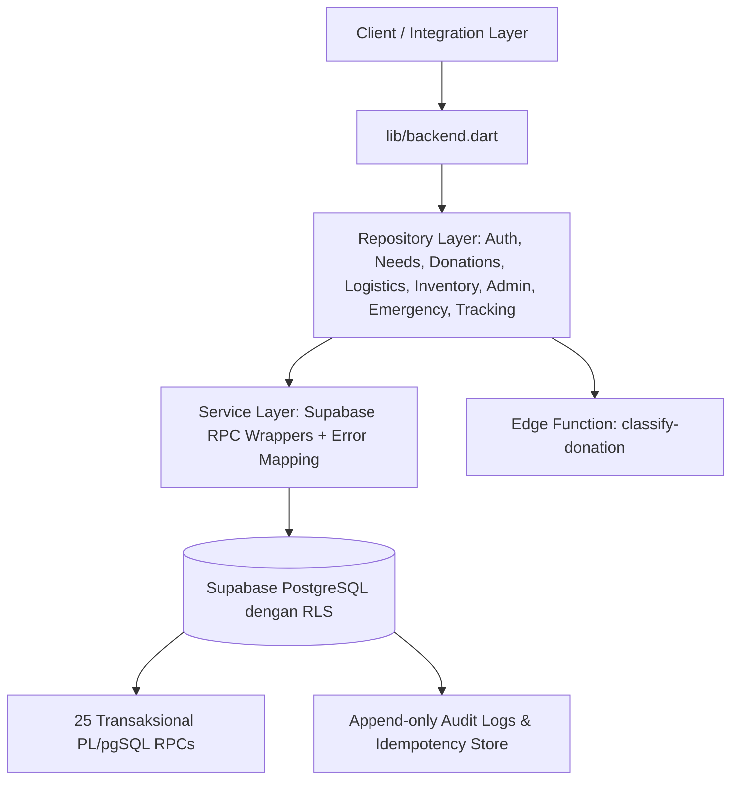

# PakaianKita — Backend Engine & Architecture

> Platform logistik donasi pakaian sandang berbasis kurasi fisik, transparansi kebutuhan, dan tanggap darurat bencana.

Dokumentasi ini mencakup implementasi backend menyeluruh yang dibangun di atas **Supabase (PostgreSQL 15+, RLS, Security Definer PL/pgSQL RPC, Realtime, Storage)** serta lapisan arsitektur client **Dart Clean Architecture (Services, Repositories, DTO Models, Domain Failures)** sesuai spesifikasi `architecture.md` dan `api-contracts.md`.

---

## 1. Arsitektur Sistem



### Prinsip Utama Backend:
1. **Otoritas Tunggal Database**: Validasi hak akses, saldo stok, status alokasi, dan penghitungan kuantitas dilakukan di dalam transaksi PostgreSQL melalui fungsi RPC atomik.
2. **Proteksi Idempotensi**: Semua mutasi menerima `p_request_key uuid`. Jika terjadi kegagalan jaringan atau timeout, client melakukan retry dengan payload dan request key yang sama tanpa menimbulkan efek ganda.
3. **Pemisahan Data Publik dan Privat**: Data sensitif (alamat penjemputan, kontak WhatsApp, data sengketa) dipisahkan ke skema privat dan hanya dapat diakses melalui fungsi berizin bagi aktor yang ditugaskan.
4. **Kurasi Sebelum Stok**: Donasi yang diajukan tidak langsung menjadi stok siap salur sebelum melewati verifikasi fisik bertingkat (3 Ikrar Kelayakan: Bersih, Utuh, Bebas Robek) dan inspeksi relawan.

---

## 2. Katalog 25 Atomic RPC Database

Seluruh fungsi database didefinisikan secara lengkap pada [`schema.sql`](file:///g:/inception-hackathon/schema.sql):

| No | Nama RPC | Hak Akses | Deskripsi & Validasi Invariant |
|:--:|---|---|---|
| 1 | `get_my_context` | Authenticated | Mengambil profil pengguna, role aktif, membership organisasi, dan konteks peran. |
| 2 | `list_needs` | Public / Invoker | Menampilkan daftar kebutuhan dengan filter jenis, ukuran, usia, wilayah, dan prioritas bencana. |
| 3 | `get_need_detail` | Public / Invoker | Menampilkan rincian kebutuhan, baris spesifikasi pakaian, dan target titik kumpul. |
| 4 | `find_matches` | Authenticated | Algoritma matching deterministik mencocokkan stok/donasi ke kebutuhan aktif terdekat. |
| 5 | `list_points` | Public / Invoker | Daftar titik kumpul (posko/gudang) yang terverifikasi dan aktif. |
| 6 | `list_my_tasks` | Relawan Aktif | Mengambil daftar tugas logistik yang ditugaskan ke relawan bersangkutan. |
| 7 | `list_inventory` | Authenticated | Menampilkan saldo stok batch (`on_hand`, `reserved`, `available`) per titik. |
| 8 | `get_my_impact` | Donatur | Ringkasan dampak donasi: jumlah diterima baik, disalurkan, dan didaur ulang. |
| 9 | `create_donation_draft` | Donatur | Menginisialisasi draft donasi baru dengan tracking code unik secara idempoten. |
| 10 | `save_donation_draft` | Pemilik Donasi | Menyimpan spesifikasi pakaian, checklist kelayakan, metode, dan kontak privat. |
| 11 | `register_donation_photo` | Pemilik Donasi | Mendaftarkan path penyimpanan foto donasi ke database. |
| 12 | `review_donation` | Relawan / Admin | Meninjau pengajuan donasi (approve atau request revision). |
| 13 | `record_inspection` | Relawan Ditugaskan | Mencatat hasil kurasi fisik (memisahkan kuantitas layak ke batch dan cacat ke rujukan daur ulang). |
| 14 | `save_need` | Mitra Pengelola | Membuat atau memperbarui kebutuhan sandang baru beserta rincian barisnya. |
| 15 | `publish_need` | Mitra Pengelola | Memvalidasi dan mempublikasikan kebutuhan agar terbuka untuk alokasi/donasi. |
| 16 | `change_need_status` | Mitra / Admin | Mengubah status kebutuhan (`active`, `paused`, `fulfilled`, `closed`). |
| 17 | `reserve_allocation` | Operator Sumber / Admin | Mengunci stok batch secara atomik untuk dialokasikan ke kebutuhan tertentu. |
| 18 | `create_shipment` | Operator Sumber | Membuat pengiriman dari alokasi stok yang telah di-reserve. |
| 19 | `dispatch_shipment` | Relawan / Operator | Mendispatch barang keluar dari titik asal (mengurangi stok fisik dan reserved). |
| 20 | `confirm_receipt` | Mitra Penerima | Mengonfirmasi penerimaan kiriman (mencatat good, rejected, missing, dan membuka sengketa jika ada selisih). |
| 21 | `cancel_allocation` | Operator / Admin | Membatalkan reservasi alokasi yang belum dikirim dan mengembalikan saldo stok bebas. |
| 22 | `resolve_dispute` | Admin | Menyelesaikan sengketa pengiriman dan menyesuaikan kuantitas held. |
| 23 | `request_incident` | Mitra Terverifikasi | Mengajukan deklarasi kejadian bencana alam ke sistem. |
| 24 | `activate_incident` | Admin | Mengesahkan masa aktif kejadian bencana dan memberikan prioritas penyaluran darurat. |
| 25 | `close_incident` | Admin | Menutup masa tanggap bencana setelah penanganan selesai. |

---

## 3. Pemetaan Kode Error Domain (api-contracts.md)

Setiap kegagalan transaksi memicu exception PostgREST dengan kode SQLSTATE terstandar yang otomatis dipetakan ke subclass `AppFailure` melalui `ErrorMapper`:

| SQLSTATE | Domain Failure Class | Penjelasan |
|---|---|---|
| `P1001` | `AuthRequiredFailure` | Sesi tidak valid atau telah berakhir. |
| `P1002` / `42501` | `ForbiddenFailure` | Pelanggaran RLS atau aktor tidak berhak atas entitas ini. |
| `P1003` / `23514` | `ValidationErrorFailure` | Validasi input gagal atau kuantitas tidak sesuai. |
| `P1004` | `VersionConflictFailure` | Terjadi perubahan konkurensi (optimistic lock conflict). |
| `P1005` | `StockConflictFailure` | Kuantitas yang diminta melebihi stok tersedia (`available`). |
| `P1006` | `NeedClosedFailure` | Kebutuhan telah ditutup atau melewati tenggat waktu. |
| `P1007` | `InvalidTransitionFailure` | Status transisi objek saat ini tidak menerima tindakan yang dipilih. |
| `P1008` / `23505` | `IdempotencyConflictFailure` | Kunci idempotensi lama digunakan dengan payload muatan yang berbeda. |
| `P1009` | `AlreadyConfirmedFailure` | Konfirmasi serah terima barang atau penerimaan sudah bersifat final. |
| HTTP `503` | `AiUnavailableFailure` | Layanan AI Edge Function tidak tersedia (fallback manual). |
| Timeout / Socket | `NetworkFailure` | Kegagalan koneksi jaringan transport. |

---

## 4. Lapisan Repositori & Service (Dart Clean Architecture)

Semua komponen backend diekspor secara sentral melalui [`lib/backend.dart`](file:///g:/inception-hackathon/lib/backend.dart):

```dart
import 'package:resandang/backend.dart';

// Contoh: Reservasi Alokasi Stok Atomik
final inventoryRepo = InventoryRepository();
final allocationId = await inventoryRepo.reserve(
  batchId: 'uuid-batch',
  needItemId: 'uuid-need-item',
  quantity: 8,
);

// Contoh: Menyimpan dan Mengirimkan Donasi
final donationsRepo = DonationsRepository();
final draft = await donationsRepo.createDraft();
await donationsRepo.saveDraft(
  donationId: draft['donation_id'],
  pointId: 'uuid-point',
  method: 'dropoff',
  cleanCheck: true,
  intactCheck: true,
  notTornCheck: true,
  items: [{'category': 'Kaos', 'size_code': 'L', 'quantity': 5}],
);
await donationsRepo.submitDonation(draft['donation_id']);
```

---

## 5. Data Sintetis Demo (`supabase/seed.sql`)

Sesuai `hackathon-plan.md` Bagian 5, data sintetis telah disiapkan dengan provenance lengkap (`donations` → `items` → `inspections` → `batches` → `allocations`):

- **4 Peran Akun Demo**: Donatur, Sahabat Sandang (Relawan), Mitra Posko Sumber, Mitra Posko Bencana, dan Admin.
- **Titik Kumpul Utama**: Titik Kumpul Demo A (Bandung) dengan stok awal 12 potong pakaian anak terkurasi.
- **Kebutuhan Rutin**: Panti Asuhan Kasih (8 potong pakaian anak).
- **Kebutuhan Darurat Bencana**: Simulasi Banjir Bandang Dayeuhkolot (10 potong pakaian anak).
- **Alur Kurasi Sempurna**: 10 potong pakaian masuk diinspeksi menjadi 8 layak pakai (masuk stok batch) dan 2 rusak (diterbitkan rujukan daur ulang).

---

## 6. Deployment & Migrasi Database

Untuk menerapkan schema dan seed data pada proyek Supabase:

```bash
# 1. Terapkan schema dan seluruh RPC transaksional
supabase db execute --file schema.sql

# 2. Masukkan data sintetis demo
supabase db execute --file supabase/seed.sql

# 3. Deploy Edge Function klasifikasi donasi
supabase functions deploy classify-donation
```
