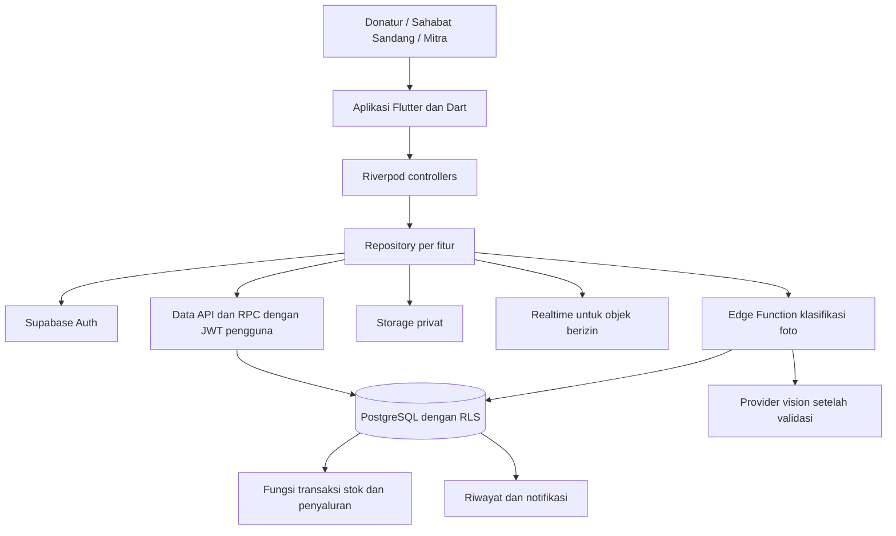
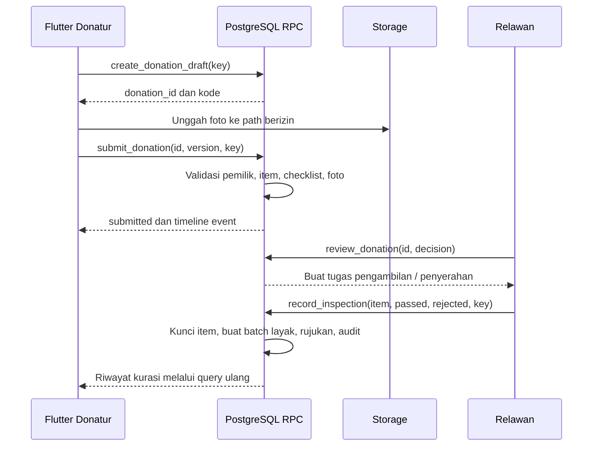
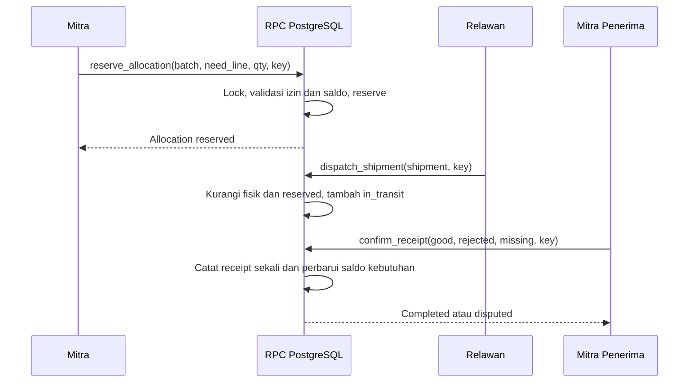

# Arsitektur Flutter dan Supabase PakaianKita

Versi 1.0 · 30 Oktober 2026 · Rancangan implementasi hackathon

## 1. Pilihan sistem

Aplikasi ditulis dalam Dart dengan Flutter. Backend menggunakan Supabase Auth, PostgreSQL, Storage, dan Realtime. Operasi domain yang mengubah beberapa tabel dijalankan dalam database function/RPC. Edge Function dipakai untuk integrasi AI dan pekerjaan yang memerlukan secret. Tidak diperlukan backend Node/Express terpisah untuk MVP.

Kode pendukung Edge Function ditulis TypeScript pada runtime yang didukung Supabase; ini tidak mengubah pilihan Flutter/Dart sebagai bahasa aplikasi. Logika stok dan akses memakai SQL/PLpgSQL. Jika AI ditunda, alur inti tetap berfungsi tanpa Edge Function AI.

### Diagram komponen



Auth menetapkan identitas; tabel grant dan membership menetapkan hak domain. Data API membaca data sesuai RLS, sedangkan RPC menjaga perubahan status/kuantitas dalam satu transaksi. Storage menyimpan media yang aksesnya mengikuti objek domain. Realtime memicu refresh, bukan menentukan kebenaran stok.

## 2. Struktur aplikasi

Gunakan pola per fitur dengan pemisahan presentation, model, repository, dan service. Pemisahan UI serta data selaras dengan [panduan arsitektur Flutter](https://docs.flutter.dev/app-architecture/guide); Riverpod adalah pilihan proyek untuk state dan dependency injection.

```text
lib/
  main.dart
  bootstrap.dart
  app/
    app.dart
    router.dart
    route_guards.dart
    environment.dart
    app_session_controller.dart
  core/
    theme/              # color_tokens, typography, app_theme
    widgets/            # async_content, status_badge, primary_button
    errors/             # app_failure, error_mapper
    utils/              # clock, quantity, tracking_code formatting
    services/           # supabase_client_provider, image_service
    cache/              # draft_store, cached_snapshot
  features/
    auth/
      models/           # app_profile, role_grant, organization_membership
      data/             # auth_repository, supabase_auth_service
      presentation/     # login_screen, onboarding_screen, auth_controller
    needs/
      models/           # need, need_line, need_filter
      data/             # needs_repository, needs_service
      presentation/     # need_list_screen, need_detail_screen, need_editor
    donations/
      models/           # donation, donation_item, donation_draft
      data/             # donations_repository, donations_service
      presentation/     # donation_wizard, donation_controller, detail_screen
    curation/           # review_queue, physical_inspection, ai_suggestion
    inventory/          # stock_list, allocation_editor, stock_repository
    logistics/          # task_list, task_detail, handover_controller
    emergency/          # incident_editor, activation, emergency_repository
    tracking/           # timeline, donor_report, receipt_detail
    collection_points/  # point_list, point_map, point_detail
    notifications/      # activity_list, unread_controller
    operations/         # admin verification, dispute resolution
    profile/            # role switch, preferences, sign out
assets/
  fonts/
  icons/
  images/demo/
supabase/
  migrations/
  functions/classify-donation/
  seed.sql              # data sintetis, bukan password atau secret
test/
integration_test/
```

Setiap folder fitur mengikuti model/data/presentation saat bertambah kompleks. Tidak perlu membuat interface dan use case untuk setiap getter sederhana; use case tersendiri dibenarkan untuk orkestrasi upload atau alur banyak langkah.

### Tanggung jawab lapisan

- Widget menampilkan state dan mengirim intent; tidak memanggil query Supabase langsung.
- Controller menangani validasi form, loading, navigasi setelah sukses, dan invalidasi cache.
- Repository menggabungkan layanan remote/cache dan menghasilkan model domain.
- Service membungkus Supabase SDK, parsing DTO, upload, dan pemetaan error transport.
- Database menjadi otoritas untuk izin, status, kuantitas, waktu server, dan audit.

State minimal: `loading`, `data`, `empty`, `failure`, ditambah `isSubmitting` pada form. Pisahkan state filter daftar dari draft donasi. Repositori menerima dependency melalui provider agar lingkungan demo dan produksi tidak tertukar.

## 3. Dependensi yang direncanakan

`supabase_flutter`, `flutter_riverpod`, `go_router`, `image_picker`, `flutter_image_compress`, `uuid`, dan `intl`. Peta menggunakan `flutter_map` dengan penyedia tile yang lisensi/atribusi dan kuotanya disetujui; daftar titik tetap tersedia jika peta belum siap. QR menggunakan `qr_flutter` dan `mobile_scanner` bila waktu memungkinkan. Draft lokal dapat memakai `shared_preferences` untuk JSON kecil tanpa secret; token sesi ditangani melalui mekanisme penyimpanan SDK yang dievaluasi keamanan perangkatnya sebelum pilot.

Versi paket tidak dibekukan dalam dokumen karena perlu dicocokkan dengan Flutter SDK tim. Saat bootstrap, pilih versi kompatibel, jalankan resolver, simpan `pubspec.lock`, dan hindari upgrade paket menjelang demo.

## 4. Sesi dan otorisasi

Startup: inisialisasi Supabase → pulihkan sesi → ambil profile/grant/membership → buka shell per peran. Selama data hak akses belum terbaca, tampilkan loading. Auth guard membantu UX; akses sebenarnya tetap di server.

Grant relawan dan membership mitra tidak dapat diterbitkan dari form profil sendiri. Admin demo di-bootstrap melalui jalur server/CLI yang dikuasai tim. Jangan memakai `user_metadata` yang dapat diubah pengguna sebagai sumber izin admin.

Perubahan grant harus terbaca di RPC pada setiap operasi penting. Token login saja tidak membuktikan pengguna masih menjadi anggota organisasi. Sign out membatalkan subscription dan menghapus cache privat dari sesi sebelumnya.

## 5. Alur donasi



Upload foto dan commit database tidak merupakan transaksi tunggal. Karena itu dibuat draft dahulu; foto orphan dibersihkan melalui pekerjaan maintenance dengan batas usia. Tidak menghapus file yang masih direferensikan pengajuan aktif. AI tidak dijalankan di dalam transaksi stok.

## 6. Pencocokan kebutuhan

Matching MVP berupa aturan transparan. Kandidat wajib memiliki jenis, ukuran terkontrol, kelompok usia yang sesuai, need aktif, titik aktif, tenggat belum lewat, dan sisa kebutuhan positif. Matching final hanya menerima batch layak.

Urutan: kebutuhan darurat yang sudah disahkan → jarak titik asal ke tujuan → tenggat terdekat → waktu dibuat dan ID sebagai tie breaker stabil. Untuk rekomendasi prakurasi, lokasi asal yang digunakan hanya dalam query privat; hasil publik tidak mengungkap koordinat rumah donatur.

Sisa kebutuhan = requested − received_good − reserved − in_transit − held_dispute. Kuantitas usulan = min(stok tersedia, sisa kebutuhan). Jarak dapat dihitung dengan koordinat dan fungsi PostGIS jika extension dipasang di schema yang ditetapkan migrasi; fallback pilot adalah urutan wilayah dan jarak Haversine di query server.

Hasil matching tidak memesan barang. `reserve_allocation` memeriksa kembali kondisi dalam transaksi sehingga rekomendasi lama tidak menyebabkan overbooking. Jangan menyebut matching ini sebagai AI jika hanya menggunakan aturan tersebut.

## 7. Stok dan penyaluran

Satu donasi memiliki banyak baris item; satu hasil kurasi menghasilkan batch layak pada titik tertentu. Batch dapat dialokasikan sebagian ke beberapa kebutuhan. Satu allocation hanya berasal dari satu batch dan menuju satu need line. Beberapa allocation dapat digabung dalam satu shipment jika asal dan tujuan sama.

Operasi reserve, dispatch, receipt, cancel, dan reallocate memakai RPC. Urutan lock konsisten: need line menurut ID → batch menurut ID → allocation menurut ID → shipment. Fungsi yang membuat shipment mengikuti urutan ini; data awal dibaca sebagai petunjuk, lalu dibaca ulang setelah lock. Retry deadlock/serialization dibatasi dan memakai idempotency key yang sama.

### Alur pengiriman



Penolakan/missing menahan kuantitas kebutuhan dalam `held_dispute` sampai admin menyelesaikan kasus. Barang retur hanya kembali ke stok sesudah diterima fisik dan dikurasi ulang; klik penyelesaian sengketa tidak menciptakan stok.

## 8. Mode Bencana

Mitra mengajukan incident dan kebutuhan. Admin menyetujui masa aktif. Matching membaca incident aktif dengan waktu server; tidak mengandalkan cron agar prioritas berakhir. Pengesahan tidak otomatis mengambil stok yang sudah dipesan untuk mitra lain.

MVP memprioritaskan stok bebas. Pengalihan reservasi yang belum dikirim memakai satu RPC admin, alasan wajib, lock asal/tujuan, dan audit. Barang yang sudah dikirim tidak dapat dialihkan menggunakan operasi reserve; buat tugas penanganan manual sesuai kondisi logistik.

## 9. AI dan Edge Function

`classify-donation` memverifikasi JWT serta kepemilikan/penugasan objek, membaca foto privat yang relevan, memanggil provider model vision yang telah divalidasi, memvalidasi JSON hasil, lalu menyimpan saran. Jangan menerima URL arbitrer pengguna untuk di-fetch oleh server.

Timeout usulan 15 detik, maksimal satu retry untuk kegagalan sementara dan batas panggilan per akun/donasi. Status: pending, processing, succeeded, failed, unsupported. Jika model tidak mendukung gambar, simpan unsupported dan gunakan pemeriksaan manual. Label `demo_fixture` harus terlihat jika demo memakai hasil contoh.

Kunci provider dan service role hanya ada di server. Edge Function memakai konteks pengguna untuk query domain bila memungkinkan; jika memakai service role untuk pekerjaan internal, periksa otorisasi secara eksplisit karena service role melewati RLS. Saran AI tidak pernah menulis saldo inventaris.

## 10. Realtime, cache, dan notifikasi

Aktifkan Postgres Changes hanya pada tabel aman yang dibutuhkan: donation_events yang telah disanitasi dan notifications milik pengguna. Payload tidak memuat alamat, kontak, atau signed URL. Subscriptions dibatasi objek; saat app kembali aktif atau koneksi pulih, fetch ulang snapshot. Tidak menganggap event yang hilang sebagai data sudah sinkron.

Draft dapat diedit offline. Reserve, dispatch, dan receipt tidak diantrekan untuk dijalankan otomatis saat online karena stok bisa berubah; pengguna harus meninjau ulang. MVP memakai notifikasi dalam aplikasi, bukan janji push notification yang belum dibangun.

## 11. Konfigurasi dan deployment

- Client: `SUPABASE_URL`, `SUPABASE_PUBLISHABLE_KEY`, `APP_ENV`, `AI_ENABLED`. Konfigurasi publik dapat diberikan melalui dart-define. Publishable key bukan secret pengganti RLS.
- Server: kredensial provider AI dan akses layanan internal melalui secrets yang dikelola server.
- Lingkungan: local untuk pengembangan jika tooling tersedia; satu proyek Supabase terpisah untuk demo dengan data sintetis; produksi pilot dipersiapkan sesudah validasi.
- Urutan: migrations → grants/RLS → functions → Storage policies → data demo → Flutter config → build APK → smoke check akun per peran.
- Simpan migrasi dalam version control. Jangan memperbaiki schema demo lewat Dashboard tanpa merekam perubahan dalam migrasi.
- Distribusi Android: APK bertanda tangan untuk pemasangan perangkat demo. Ketersediaan iOS tergantung lingkungan build, sertifikat, dan perangkat tim.

Tidak menetapkan biaya hosting atau kuota gratis sebagai jaminan. Sebelum demo cek ukuran Storage, egress, koneksi Realtime, serta batas proyek yang dipakai. Foto dikompresi dan query dipaginasi untuk membatasi beban.

## 12. Observabilitas dan validasi

Catat request ID, nama operasi, actor ID internal, durasi, kode error, dan domain event. Jangan mencatat password, token, alamat lengkap, atau foto. Audit operasional append-only memuat before/after untuk field penting dengan redaksi PII.

Pengujian saat implementasi berfokus pada: izin lintas akun, race condition dua reserve, duplikasi receipt, paket campuran, pembatalan, pengiriman sebagian, dan fallback AI. UI smoke test mencakup alur tiga peran. Dokumen ini belum mengeksekusi pengujian aplikasi karena aplikasi belum dibangun.

## 13. Rujukan

- [Flutter architecture](https://docs.flutter.dev/app-architecture/guide): tanggung jawab view, controller/view model, repository, dan service.
- [Supabase Flutter quickstart](https://supabase.com/docs/guides/getting-started/quickstarts/flutter): SDK client dan inisialisasi.
- [Supabase database functions](https://supabase.com/docs/guides/database/functions): fungsi database dan pengamanan eksekusi.
- [Supabase Realtime Postgres Changes](https://supabase.com/docs/guides/realtime/postgres-changes): subscription perubahan dan publication.
- [Securing Edge Functions](https://supabase.com/docs/guides/functions/auth): autentikasi panggilan fungsi. Sesuaikan implementasi dengan SDK/runtime yang dipakai.
