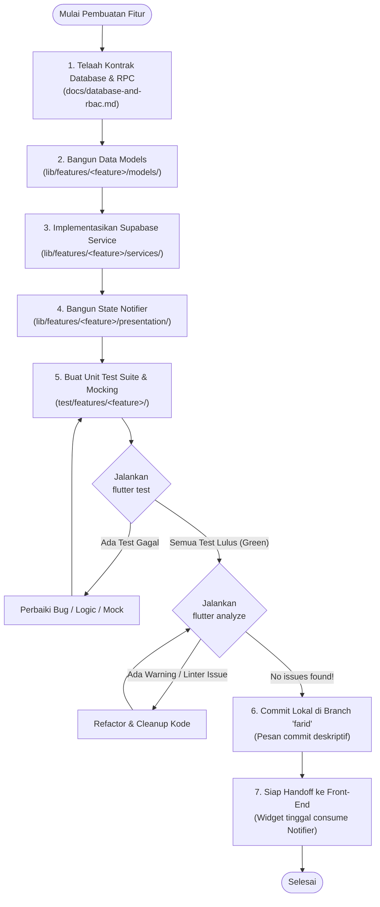

# Workflow Pengembangan Fitur PakaianKita (Flutter & Supabase)

Dokumen ini menjadi acuan standar alur kerja (*standard operating procedure*) pengembangan fitur di platform **PakaianKita**. Alur kerja ini dirancang khusus untuk memfasilitasi kolaborasi paralel yang rapi antara pengembang backend/core logic dan pengembang antarmuka (Front-End/UI).

---

## 1. Prinsip Utama Kolaborasi

1. **Pemisahan Peran (Separation of Concerns)**:
   - **Front-End Developer**: Mengembangkan antarmuka, layout, komponen visual, dan interaksi layar berdasarkan desain FigCraft/Figma.
   - **Backend/Core Developer**: Mengembangkan kontrak data (models), client services Supabase (RPC & Query), state management notifiers, dan test suite.
   - **Aturan No-Dummy-UI**: Pengembang backend dilarang membuat widget UI dummy atau layout sementara yang berisiko bertabrakan/berbeda visual dengan rancangan desainer Front-End.
2. **Git Branching & Commit Sederhana**:
   - Pengerjaan fitur dilakukan langsung pada branch **`farid`** secara lokal.
   - Setiap fitur yang selesai diuji langsung di-**`commit`** di branch `farid` tanpa perlu membuat branch fitur baru setiap saat.
   - Push ke remote GitHub atau pembukaan Pull Request hanya dilakukan setelah ada instruksi dan persetujuan.
3. **Standar Kualitas Wajib Sebelum Commit**:
   - `flutter test`: **100% lulus (green)** tanpa error.
   - `flutter analyze`: **0 issue / No issues found!**.

---

## 2. Flowchart Alur Kerja (Feature Development Lifecycle)



---

## 3. Detail Tahapan Pengembangan

### Tahap 1: Telaah Kontrak Database & RPC
- Periksa schema database, tabel, kolom, enum, RLS, serta parameter RPC pada [docs/database-and-rbac.md](docs/database-and-rbac.md).
- Pastikan memahami peran pengguna yang berwenang (misal: role `donatur`, `relawan`, `mitra`, atau `admin`).
- Catat nama parameter RPC secara presisi (contoh: `p_id`, `p_status`).

---

### Tahap 2: Pembuatan Data Model (`lib/features/<fitur>/models/`)
- Representasikan data tabel Supabase ke dalam kelas Dart immutable.
- Sertakan constructor, field typed, factory `fromJson(Map<String, dynamic> json)`, dan `toJson()`.
- Lakukan penanganan nilai `null` dan format tanggal (`DateTime.tryParse`) secara aman.
- Contoh struktur:
  ```dart
  class LogisticsTask {
    final String id;
    final String kind;
    final String status;
    final DateTime createdAt;

    const LogisticsTask({
      required this.id,
      required this.kind,
      required this.status,
      required this.createdAt,
    });

    factory LogisticsTask.fromJson(Map<String, dynamic> json) {
      return LogisticsTask(
        id: json['id'] as String,
        kind: json['kind'] as String,
        status: json['status'] as String,
        createdAt: DateTime.parse(json['created_at'] as String),
      );
    }
  }
  ```

---

### Tahap 3: Supabase Client Service (`lib/features/<fitur>/services/`)
- Buat class service dengan dependency injection `SupabaseClient`.
- Pisahkan antara operasi query tabel langsung (dengan RLS) dan pemanggilan fungsi RPC:
  - **Query Tabel**: `_client.from('nama_tabel').select(...)`
  - **RPC Database**: `_client.rpc('nama_rpc', params: { ... })`
- Tangkap dan format error menggunakan `PostgrestException` jika diperlukan.
- Contoh struktur:
  ```dart
  class LogisticsService {
    final SupabaseClient _client;
    LogisticsService(this._client);

    Future<void> respondTask({
      required String taskId,
      required String status,
    }) async {
      await _client.rpc('respond_task', params: {
        'p_id': taskId,
        'p_status': status,
      });
    }
  }
  ```

---

### Tahap 4: State Notifier (`lib/features/<fitur>/presentation/`)
- Gunakan `ChangeNotifier` agar antarmuka Front-End dapat dengan mudah merefleksikan perubahan status secara reaktif tanpa dependensi framework state yang kaku.
- State utama yang wajib dikelola:
  - `isLoading`: Indikator loading data.
  - `errorMessage`: Pesan error jika terjadi kegagalan request.
  - `data / list`: Objek data hasil fetch.
- Sediakan method publik untuk dipanggil oleh UI (misal: `loadTasks()`, `submitInspection()`).

---

### Tahap 5: Unit Testing & Mocking (`test/features/<fitur>/`)
- Setiap service, model, dan notifier wajib memiliki unit test pendamping menggunakan package `test` dan `mocktail`.
- Gunakan fake builder untuk menangani rantai pemanggilan fluent API Supabase:
  - `FakePostgrestFilterBuilder`
  - `FakePostgrestTransformBuilder`
- Uji skenario sukses (*happy path*) dan skenario gagal (*error handling*).

---

### Tahap 6: Verifikasi Kualitas (Quality Gates)
Jalankan verifikasi sebelum melakukan commit:
```bash
# 1. Jalankan seluruh test suite
flutter test

# 2. Jalankan analisa linter statis
flutter analyze
```
Pastikan kedua perintah keluar dengan kode status `0` tanpa peringatan.

---

### Tahap 7: Git Commit di Branch `farid`
Lakukan staging file perubahan (kecuali file kredensial/dokumentasi lokal internal) dan commit langsung di branch `farid`:
```bash
# Cek file yang berubah
git status

# Tambahkan file fitur yang relevan
git add lib/features/<fitur>/ test/features/<fitur>/ docs/

# Buat commit deskriptif
git commit -m "feat: implement Phase X <nama fitur> models, services, notifiers and tests"
```

---

### Tahap 8: Handoff & Integrasi Front-End
Saat rekan Front-End selesai merancang UI:
1. Import Notifier ke widget/screen terkait.
2. Bungkus komponen UI menggunakan `ListenableBuilder` atau `AnimatedBuilder`.
3. Panggil method notifier saat tombol ditekan atau layar dimuat:
   ```dart
   ListenableBuilder(
     listenable: taskNotifier,
     builder: (context, _) {
       if (taskNotifier.isLoading) return const CircularProgressIndicator();
       if (taskNotifier.errorMessage != null) return Text(taskNotifier.errorMessage!);
       return TaskListView(tasks: taskNotifier.tasks);
     },
   );
   ```

---

## 4. Struktur Folder Standar

```text
lib/
├── core/
│   ├── config/          # Konfigurasi Supabase URL & anon key
│   └── models/          # Model global (AppRole, UserAccess)
└── features/
    ├── auth/            # Autentikasi & RBAC
    ├── needs/           # Kebutuhan pakaian bencana / posko
    ├── donation/        # Alur donasi pakaian, checklist, & timeline
    ├── logistics/       # Tugas kurasi relawan, alokasi & pengiriman
    ├── disaster/        # Mode bencana, kebutuhan darurat, & pencocokan stok terkurasi
    └── collection_points/ # Titik posko / drop point
```
Setiap folder di dalam `features/` mengikuti pembagian subfolder:
- `models/`: Representasi entity data dan parsing JSON.
- `services/`: Panggilan API/RPC Supabase.
- `presentation/`: State notifier controller untuk UI.
